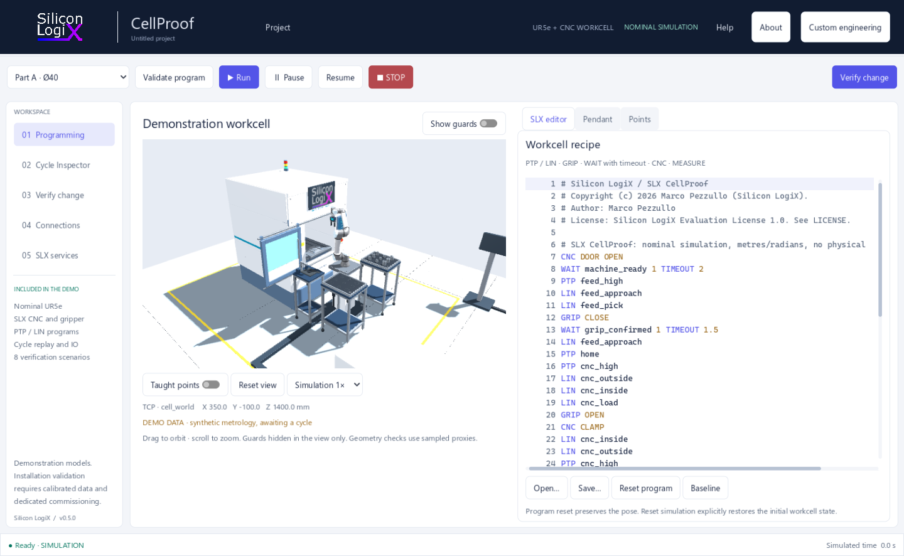
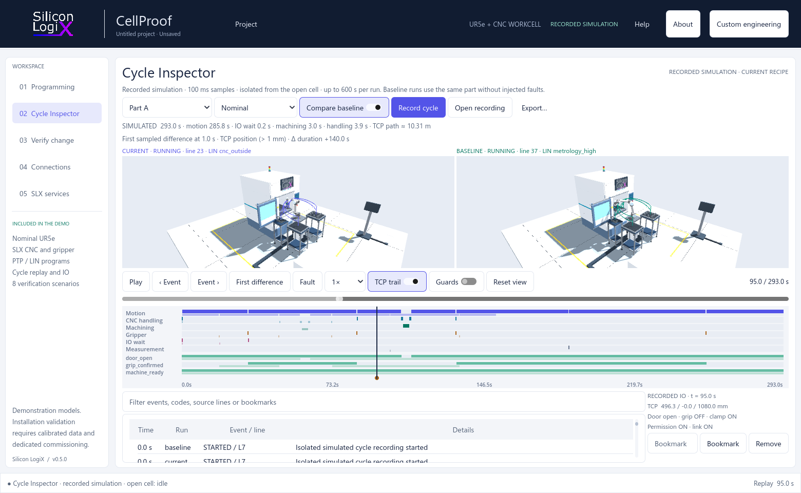

<!--
Silicon LogiX / SLX CellProof
Copyright (c) 2026 Marco Pezzullo (Silicon LogiX).
Author: Marco Pezzullo
License: Silicon LogiX Evaluation License 1.0. See LICENSE.
-->

# SLX CellProof 0.5.0

[](https://github.com/Silicon-Logix/slx-cellproof/actions/workflows/validate.yml)
[](https://github.com/Silicon-Logix/slx-cellproof/releases)

[Download Windows installer or portable package](https://github.com/Silicon-Logix/slx-cellproof/releases)

Program, verify and compare changes to a UR5e-CNC demonstration workcell.
CellProof runs locally with an English interface and no mandatory account.



## Features

- Articulated 3D workcell with orbit, zoom and taught-point markers.
- SLX program editor with PTP/LIN, gripper, IO waits and CNC instructions.
- Teach pendant with joint/TCP jog and single-instruction stepping.
- Local recipe import/export and editable taught points.
- Eight-scenario verification campaigns, fault recovery and baseline comparison.
- Cycle Inspector with synchronized 3D replay, phase / IO timeline and first sampled difference.
- Cycle bookmarks, filtered events and local JSON recording / CSV sample export.
- HTML/JSON reports separating simulated time, host time and synthetic metrology.
- Read-only URSim/UR5e RTDE monitoring.
- Built-in Help, About, license and third-party credits.
- Complete `.cellproof` projects with persistent recipes, reference baseline, scenarios, recordings, notes and view settings.
- Recoverable autosaves, previous-save backup, recent projects and on-disk conflict detection.
- Per-user Windows installer, project file association and explicit integrity-checked updates.

## Run on Windows

Run the Windows installer for a per-user installation, shortcuts and optional
`.cellproof` file association. Alternatively, extract the portable package and
start `CellProof.exe`; keep the executable, resource pack and `bin/` together.

1. Select part A or B and choose **Validate program**.
2. Choose **Run**, or **Verify change** to execute all eight scenarios.
3. Save a baseline, edit a taught point or recipe and compare the outcomes.
4. Save a local recipe or export an HTML/JSON report.
5. Open **Cycle Inspector**, choose a scenario and **Record cycle** to inspect its execution.



Press **F1** for the guide or **F12** for About. **Ctrl+O** opens a complete project,
**Ctrl+S** saves it and **Ctrl+Shift+S** selects another path. Recipe-only JSON
import/export remains in Programming. The About window includes product/runtime versions,
the license, complete third-party notices and a system-information copy action.

Unsigned development evaluation. This is not a production release.

## Interface sources

The source bundle includes the Godot interface and a Windows x64 core binary.
Use Godot **4.5.2**, open `godot/project.godot`, import the assets and run the
main scene. The interface talks to the included product core through the
documented SLX API.

Before opening the pristine source bundle in Godot, check its file inventory
with Python 3.12+:

```powershell
python scripts/audit_publication.py --public
```

## Documentation

- [User guide and keyboard shortcuts](docs/USER_GUIDE.md)
- [SLX language and API reference](docs/API_SLX_V1.md)
- [URSim setup](docs/URSIM.md)
- [Validation coverage and model limitations](docs/VALIDATION.md)
- [Advanced integrations available on request](docs/ADVANCED_FEATURES.md)
- [Installation, updates and signing policy](docs/INSTALLATION_AND_UPDATES.md)
- [Changes](CHANGELOG.md)
- [Feedback and contribution terms](CONTRIBUTING.md)
- [Security reporting](SECURITY.md)
- [Third-party notices](THIRD_PARTY_NOTICES.md)

The workcell uses nominal kinematics and sampled geometry proxies. Metrology
is synthetic. Physical robot motion, installation safety certification and
continuous/full-mesh collision validation are not provided by this demo.

## License

Copyright (c) 2026 Marco Pezzullo (Silicon LogiX).
Original SLX content uses the [Silicon LogiX Evaluation License 1.0](LICENSE).
Evaluation and private changes are permitted within its terms. Third-party
components retain their own licenses; see the included notices.

[Silicon LogiX](https://www.siliconlogix.it/)
