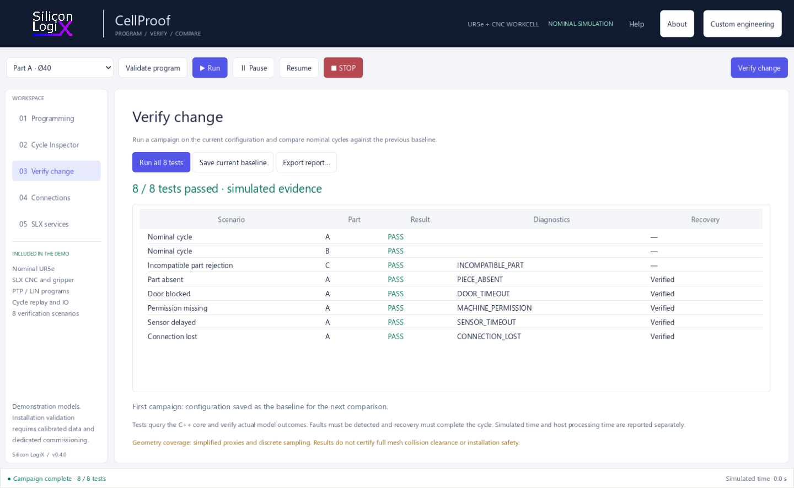

<!--
Silicon LogiX / SLX CellProof
Copyright (c) 2026 Marco Pezzullo (Silicon LogiX).
Author: Marco Pezzullo
License: Silicon LogiX Evaluation License 1.0. See LICENSE.
-->

# Validation coverage

Tested target: Windows x64, Godot 4.5.2 and the nominal UR5e-CNC demonstration
profile. The verification campaign computes model outcomes rather than playing
a precomputed report.

| Area | Verified behavior |
| --- | --- |
| Kinematics | FK against independent nominal references, Cartesian LIN and joint limits |
| Geometry | Rejection of closed-door and obstruction cases using sampled proxies |
| Workcell | Eight campaign scenarios and completed recovery for all five injected faults |
| API | Recipe round trips, baseline reruns, stepping, pose-preserving recovery and bounded malformed requests |
| RTDE | Output-only handshake, fragmented packets, telemetry decoding and stale-state reporting |
| URSim | Official e-Series 5.23.0 simulated-controller subscription; no motion commands |
| Interface | Native backend workflows, recipe editing, help, About and bundled legal documents |
| Cycle Inspector | Isolated recordings, unchanged-reference equivalence, changed-speed divergence, all five faults and 600-second truncation |
| Replay and archives | Independent 3D worlds, scrub/play/event navigation, bookmarks, JSON round trip, malformed archive rejection and CSV columns |
| Complete projects | Exact recipe/reference restoration, Unicode drafts, chunk limits, atomic rejection, idle reopening, recordings/settings persistence and autosave recovery |
| Project storage | Native atomic replacement, backup rotation, checksum and on-disk conflict rejection, ordinary project-file scope and Unicode paths |
| Desktop interaction | Five pages at three window sizes, actual toggle hover/focus, action text contrast, keyboard / modal guards and closable diagnostics |
| Update policy | Explicit checks, repository and digest restrictions, channel ordering, production signature requirements and corrupt-download rejection |
| Installer | Per-user installation, in-place upgrade, installed-runtime smoke checks, downgrade/running-instance guards and data-preserving uninstall |
| Windows packaging | Embedded multi-resolution icon, product metadata and standalone launch |
| Source bundle | Copyright notices, license provenance, exact inventory and Git line-ending consistency |

## Model limits

Runtime geometry uses simplified robot segments and boxes, sampled discretely.
Self-collision, full mesh detail and continuous swept-volume checks are excluded.
The original asset animation audit has a different scope from validation of
new programs. Demonstration metrology is synthetic and does not represent a
physical measurement.

Physical robot motion, installation safety and ROS/MoveIt/Gazebo execution are
outside this version's implemented and qualified scope. Update checks and the
installer workflow are implemented; this preview has no production certificate
or trusted production release key and is not represented as publisher-authenticated.
URSim tests concern a virtual controller; they do not qualify a physical robot.
Cycle Inspector currently records the nominal simulator only. Imported local
archives are unverified. Recording samples at 100 ms does not add continuous
collision checks or qualify physical timing. On-request modules in the service
catalogue are proposed engineering scopes, not bundled executable modules.

## Reproduce the product checks

Run **Verify change** to execute all eight model scenarios. Save a baseline and
modify a taught pick point to verify that the campaign detects a missed pick
without moving the model's part to match the edited point.

For a pristine source bundle, run the inventory check described in the README.
The repository workflow checks the source inventory and the Windows/Godot
application smoke test.
